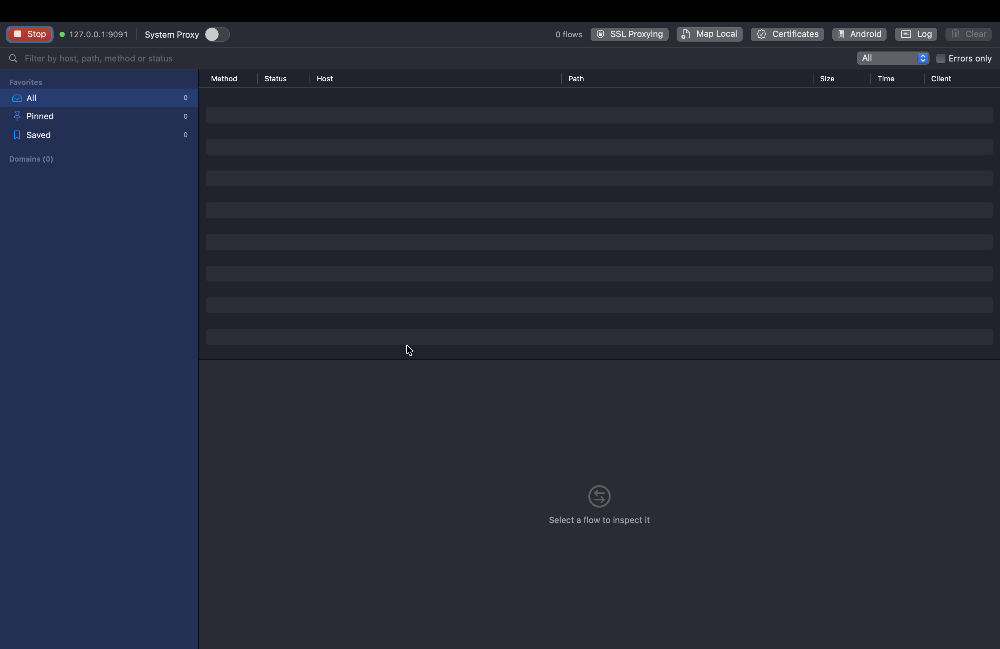
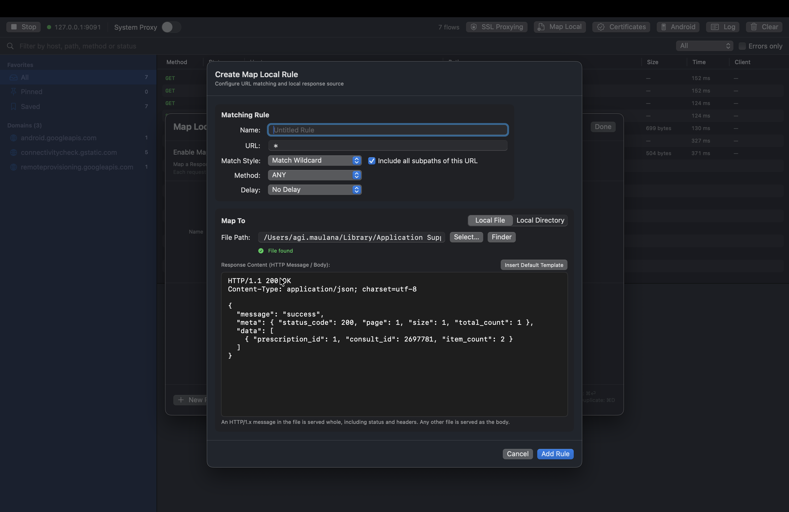
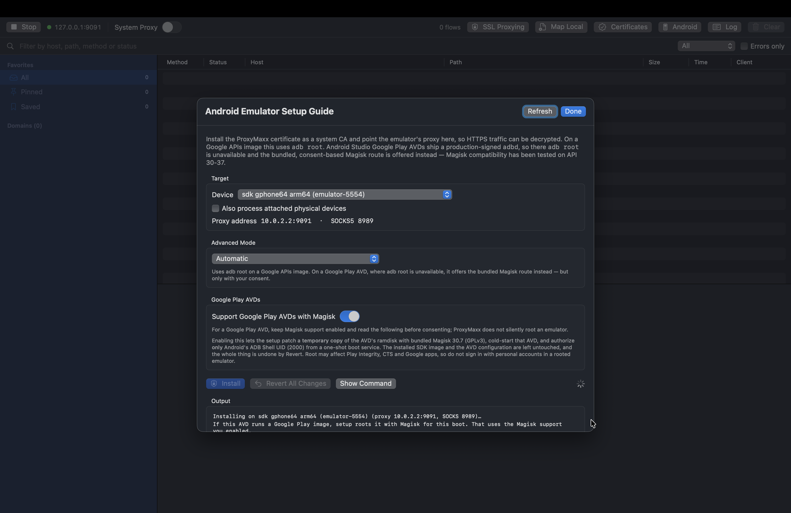
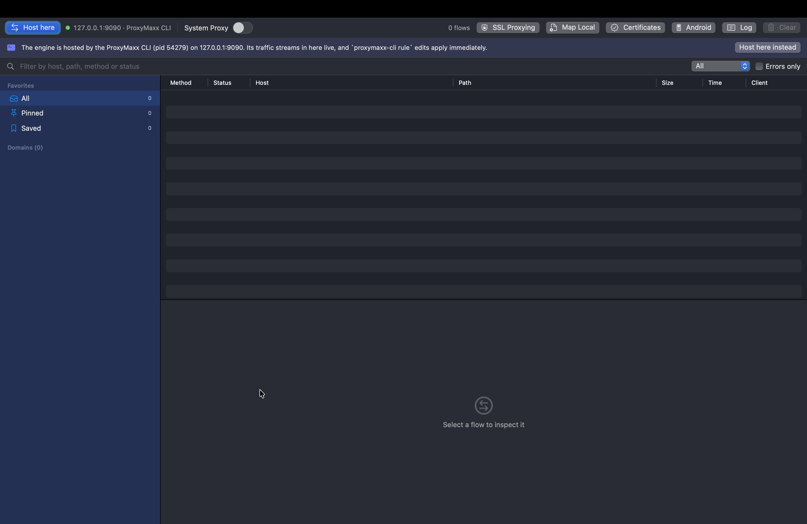

# ProxyMaxx

**A free, open-source HTTP/HTTPS debugging proxy for macOS.** ProxyMaxx sits between an app
or a device and the network, decrypts TLS, and shows you every request and response: headers,
bodies, timings and WebSocket frames. It is the MIT-licensed alternative to Charles Proxy,
Proxyman and mitmproxy for people who want a native Swift app with no licence key, no paid
tier and no account. macOS 14 or later, built with SwiftPM.

ProxyMaxx is complete as it stands: no feature is held back from this repository.



## Why ProxyMaxx

- **Free and open source.** MIT licence. No licence key, no trial, no subscription, no
  telemetry.
- **Native macOS app, not a Java or Qt wrapper.** SwiftUI front end on a SwiftNIO proxy
  engine, so it starts fast and looks like a Mac app.
- **HTTPS interception without a privileged helper.** The root CA goes into the user trust
  domain, so trusting the certificate needs no administrator password.
- **Works with phones, emulators and browsers.** One-click Android emulator and device
  setup, a bundled SOCKS5 listener, and a Chromium extension that survives policy overrides.
- **Scriptable.** `proxymaxx-cli` drives the same engine and rules from a shell or an AI
  agent.

## ProxyMaxx compared

| | ProxyMaxx | Charles Proxy | Proxyman | mitmproxy |
|---|---|---|---|---|
| Price | Free | $50 licence | Free tier + paid | Free |
| Licence | MIT | Proprietary | Proprietary | MIT |
| Native macOS UI | Yes | Java | Yes | No (TUI or web) |
| HTTPS MITM | Yes | Yes | Yes | Yes |
| Mac OS only | Yes | No | Yes | No |
| WebSocket inspection | Yes | Yes | Yes | Yes |
| Map Local | Yes | Yes | Yes | Addon |
| Map Remote | Planned | Yes | Yes | Addon |
| Breakpoints | Planned | Yes | Yes | Yes |
| Scripting | Planned | Yes | Yes | Python |
| Android emulator setup | One click | Manual | Manual | Manual |
| Headless CLI | Yes | No | Yes | Yes |
| Open source | Yes | No | No | Yes |

Feature sets move; treat this as a starting point and check each project's own documentation.

## Install

```sh
brew tap AgiMaulana/proxymaxx
brew trust --tap agimaulana/proxymaxx
brew install --cask AgiMaulana/proxymaxx/proxymaxx
```

`brew trust` is needed once when the tap is added by hand, because Homebrew will not load
a cask from a tap it does not trust. The cask clears the quarantine attribute on the app it
installs, so ProxyMaxx opens without a Gatekeeper warning.

Building from source:

```sh
git clone https://github.com/AgiMaulana/ProxyMaxx.git
cd ProxyMaxx
Scripts/bundle-app.sh
open "dist/ProxyMaxx.app"
```

A DMG works too: download `ProxyMaxx-vX.Y.Z.dmg` from
[Releases](https://github.com/AgiMaulana/ProxyMaxx/releases), mount it and drag ProxyMaxx to
Applications. The app is ad-hoc signed and not notarised, so macOS quarantines that copy and
refuses the first launch. Clear the attribute once:

```sh
xattr -dr com.apple.quarantine "/Applications/ProxyMaxx.app"
```

There is no Mac App Store build.

## Features

### HTTP/HTTPS interception

- HTTP/1.1 proxy on `127.0.0.1:9090` with CONNECT tunnelling.
- HTTPS man-in-the-middle: a local root CA signs a per-host leaf certificate; decrypted
  requests and responses are captured and shown.
- Opaque tunnelling for hosts excluded from SSL Proxying, relayed byte for byte.

### Traffic inspection

- Live traffic table (method, status, host, path, size, duration, client) with text, method
  and error filtering.
- Flow inspector: request and response headers, pretty, raw and hex bodies, JSON and form
  formatting, image preview, timings, decryption state.
- **Copy as cURL** for any request, from the inspector or the table's context menu.
- SSL Proxying list with include and exclude wildcards.

### WebSocket debugging

After a `101 Switching Protocols` the connection is handed to a raw relay, so long-lived
sockets (chat, huddles, live updates) keep working through the proxy. Text, binary and
control frames are recorded on the upgrade flow and listed in the inspector; payloads
compressed by `permessage-deflate` are forwarded untouched and shown as hex.

### Map Local

Answer a matched request from a local file or directory instead of the network. A file is
served either as a whole HTTP/1.x message (status, headers and body) or as a plain body with
the content type inferred from its extension; a directory answers the request path and falls
back to `index.html`. Rules match by Contains, Match Wildcard, Match Regex (full-match) or
Exact, optionally filtered by method, and can delay the response. Rules are evaluated top to
bottom and the first match wins. A rule whose file or directory is gone falls through to the
remote server.



### Certificates and system proxy

- One-click certificate install into the user trust domain, and CA export.
- System proxy enable and disable for all network services.

### Mobile and browser support

- A **SOCKS5 listener on `127.0.0.1:8989`** for clients that will not use the system proxy.
  The bundled [Android tunnel](Android/README.md) reaches the proxy this way. The port can be
  changed in Settings; if it is taken, the listener picks the next free one and says so.
- A **Chromium browser companion** ([Browser/README.md](Browser/README.md)): an extension that
  points a browser at the proxy through `chrome.proxy`, including when a policy, another
  extension or a command-line flag is overriding the system proxy, and then names which of
  the usual blockers (CA trust, loopback, HTTP/3, a foreign proxy owner) is still in the way.
- **Android setup, one click**: install the CA as a system certificate, set the device's
  proxy, and install and launch the [tunnel app](docs/android.md). Works on Google APIs
  emulators through `adb root`, and on Google Play AVDs through a bundled, consent-based
  [Magisk route](Resources/android/README.md). The
  [device guide](docs/android.md) covers physical phones.



### Automation

- A headless **CLI** that drives the same engine and rules, for scripts and AI agents. See
  [cli/README.md](cli/README.md).
- Verified end to end by integration tests that drive the proxy with real `curl`.

Not yet implemented, planned in order: Map Remote, Breakpoint, Scripting (JavaScriptCore),
Allow/Block list, DNS Spoofing, Network Throttling, Reverse Proxy, External/SOCKS proxy,
Compose, Diff, GraphQL/Protobuf, HTTP/2, HAR import/export, MCP server.

## Quick start

1. Launch the app and press **Start**.
2. Open **Certificates** and click **Install & Trust Certificate**. No password is needed:
   the certificate goes into the user trust domain.
3. Either toggle **System Proxy**, which applies to every network service, or point a client
   at the proxy directly:

   ```sh
   curl --proxy http://127.0.0.1:9090 http://example.com/
   curl --proxy http://127.0.0.1:9090 --cacert <exported-ca>.crt https://example.com/
   ```

4. Traffic appears in the table; select a row to inspect it.
5. Add hosts to **SSL Proxying → Exclude** to leave their TLS untouched.
6. Open **Map Local** or press Cmd+L to answer matched URLs from a local file or directory.
   Add a rule, set its URL and matching style, then pick the file or directory under
   **Map To**.

The app's menu holds the rest: **Command Line Tool…**, **Install Browser Extension…**,
**Open Android Emulator Guide** and **Open Android Device Guide**.

## Command line

`proxymaxx-cli` drives the same engine and rules, for scripts and AI agents. `serve` starts
the proxy, `flows` reads the captured session with the same filters as the window, and
`stop` shuts it down:

```sh
Scripts/build-cli.sh                            # -> Resources/proxymaxx-cli
proxymaxx-cli serve --detach --port 9090         # fire-and-forget; returns at once
proxymaxx-cli flows --host api.example.com --method POST
proxymaxx-cli stop
```

`Scripts/bundle-app.sh` rebuilds and copies the binary into the bundle, so after installing
the app the same tool runs from `ProxyMaxx.app/Contents/Resources/proxymaxx-cli` without the
checkout. The app's **ProxyMaxx → Command Line Tool…** menu shows that path with **Copy Path**
and **Open in Finder**.

See [cli/README.md](cli/README.md) for the full surface.



## Build and run

```sh
swift build                       # compile everything
swift test                        # unit and end-to-end proxy tests
Scripts/bundle-app.sh             # produce dist/ProxyMaxx.app
open "dist/ProxyMaxx.app"
```

`Scripts/bundle-app.sh` builds the companions before it packages them: the CLI, the browser
extension, and, when asked, the Android tunnel. Their staged copies under `Resources/` are
gitignored, so a stale artefact cannot be bundled by accident. The tunnel is opt-in because
its Gradle build needs a JDK and the Android SDK, and a release bundle fails outright when it
is missing.

```sh
Scripts/bundle-app.sh release --with-android-vpn   # local release bundle
Scripts/build-all.sh release                       # the same thing, for CI
```

During development, use `Scripts/run.sh` rather than `swift run`: SwiftUI reads
`Localizable.strings` from the app bundle, and an unbundled binary has no `.lproj` folder, so
it shows the symbolic keys instead of English. The runner copies the localizations beside the
binary first.

```sh
Scripts/run.sh                                    # opens the window
Scripts/run.sh debug --autostart --port 9090      # start listening immediately
```

### Releases

Pushing a `vX.Y.Z` tag runs [`.github/workflows/release.yml`](.github/workflows/release.yml),
which builds the bundle on macOS and publishes `ProxyMaxx-vX.Y.Z.dmg`. The Android tunnel
travels inside the app, so it is not a separate download; it is signed from the
`KEYSTORE_BASE64`, `STORE_PASSWORD`, `KEY_ALIAS` and `KEY_PASSWORD` repository secrets.
Without them the run still succeeds, with an unsigned tunnel that installs on an emulator
only. The same workflow renders `Scripts/homebrew/proxymaxx.rb` and pushes it to the tap,
which needs `TAP_GITHUB_TOKEN` because `GITHUB_TOKEN` cannot write to another repository.

The tap lives at [AgiMaulana/homebrew-proxymaxx](https://github.com/AgiMaulana/homebrew-proxymaxx).
Its `Casks/proxymaxx.rb` is generated: edit
[`Scripts/homebrew/proxymaxx.rb`](Scripts/homebrew/proxymaxx.rb) instead.

To build a signed tunnel locally, keep the keystore out of the checkout and point the build
at it. `STORE_FILE` is the path Gradle reads; the three credentials stay in the environment:

```sh
STORE_FILE=/path/to/release.jks STORE_PASSWORD=... KEY_ALIAS=... KEY_PASSWORD=... \
  Scripts/build-all.sh release
```

### Localization

The UI is localized with Apple's standard `Localizable.strings`. English is the source
language and lives in [`Resources/en.lproj/Localizable.strings`](Resources/en.lproj/Localizable.strings).
The keys are short, stable identifiers (`main.systemProxy`, `inspector.responseHeaders`), and
the English copy is the value. Code that builds text at runtime passes an English default, so
tests and command-line paths still read in English when no bundle is present.

To add a language, copy that file to `Resources/<language>.lproj/Localizable.strings`,
translate the values (keep the keys and any `%@` or `%lld` placeholders), and rebuild with
`Scripts/bundle-app.sh`. The bundler copies every `Resources/*.lproj` directory it finds.
Activity-log lines and Android installer output stay in English because they are diagnostics,
not UI copy.

## Privileged operations (CA trust, system proxy)

**Neither operation needs administrator rights, a password, or a privileged helper.**
Nothing is installed outside `~/Library`. Just click **Certificates → Install & Trust
Certificate**.

Why that works, and why the obvious approaches do not:

- Trust settings live in two domains with different rules:
  ```
  com.apple.trust-settings.admin  ->  [entitled, authenticate-admin]
  com.apple.trust-settings.user   ->  [entitled-session-owner-or-authenticate-session-owner]
  ```
  The admin domain needs an Apple-private entitlement or an interactive admin
  authentication. Being root satisfies neither, which is why a root daemon attempting it
  reports `The authorization was denied since no user interaction was possible`. A privileged
  helper is therefore useless for certificate trust, and ProxyMaxx does not install one.
- The user domain needs only the logged-in owner, so the app writes it directly.
- `networksetup -setwebproxy` likewise applies as the logged-in user.

The app runs `security add-trusted-cert -r trustRoot -k <user keychain>` directly, with no
helper and no elevated prompt.

Two deliberate choices in how trust is applied:

- Trust is scoped with `-p ssl -p basic` rather than granted to every policy.
- Certificates are deleted by listing SHA-1 hashes and deleting each in Swift, rather than
  piping through `awk` or `sh`, so a common name can never reach a shell.

An optional **Certificates → Authorise certificate changes with Touch ID** adds a biometric
confirmation. It is a convenience, not a gate: no authorization is actually required.

If a locked-down configuration refuses, the app escalates to a single authorised prompt
rather than failing.

## Safety around the system proxy

Turning the system proxy on redirects all HTTP/HTTPS traffic on the machine here, so the two
ways that can go wrong are handled explicitly:

- **The root certificate must be trusted first.** Enabling the system proxy is refused until
  the CA is installed; otherwise every HTTPS client rejects the intercepted certificate
  (`CERTIFICATE_UNKNOWN`) and networking appears broken.
- **The setting is put back on exit.** Quitting restores the previous system proxy, instantly
  and silently, including on Cmd+Q.
- **Leftovers are detected and repairable.** If a previous run was killed without shutting
  down, the app notices the stale setting on launch and offers a one-click **Restore**.
- **Port conflicts are reported.** If something else already listens on the port, for example
  a previous ProxyMaxx run on 9090, the app says so instead of half-binding on top of it.
  Change the port in **Settings**.

If networking is still broken after a crash, clear it from a terminal:

```sh
sudo networksetup -setwebproxystate "Wi-Fi" off
sudo networksetup -setsecurewebproxystate "Wi-Fi" off
```

## Architecture

```
Sources/
  FlowKit       Flow and HTTP models, MIME parsing, body formatting, FlowStore
  CertKit       Root CA and per-host leaf generation, caching, on-disk storage
  RuleKit       Wildcard matching, MatchingRule, SSLProxyingPolicy, Map Local rules, RuleStore
  ProxyKit      NIO proxy engine: CONNECT, TLS MITM, opaque relay, flow recording
  SystemKit     networksetup system proxy, certificate trust, the browser bridge
  CodeGenKit    request code generation (Copy as cURL)
  Branding      the app icon and accent
  BrowserHost   the browser companion's native messaging host
  ProxyMaxxApp  SwiftUI app
cli/            proxymaxx-cli, the headless front-end
Android/        the tunnel app
Browser/        the Chromium extension
Tests/
  CertKitTests      certificate chain validated with SecTrust
  CodeGenKitTests   cURL generation
  FlowKitTests      flow models and formatting
  RuleKitTests      matching rules, Map Local resolution, registry and IPC, session log
  ProxyKitTests     end-to-end MITM, opaque tunnel, plain HTTP, Map Local and WebSocket via curl
  SystemKitTests    the Android installer, browser bridge and CLI companion
```

### How the MITM works

On `CONNECT host:port` the proxy acknowledges the tunnel, then, for hosts the SSL Proxying
policy says to decrypt, inserts a TLS server handler carrying a leaf certificate for `host`
at the head of the connection pipeline and switches into tunnel mode. That certificate is
signed by the local root CA, which the user has trusted, so the client completes its
handshake with the proxy. The proxy then opens its own TLS connection upstream and relays the
decrypted request and response, recording both as a `Flow`.

Two NIO details this design depends on, both covered by tests:

- `HTTPRequestDecoder` and `HTTPResponseDecoder` are write-observing codecs, so they sit
  after their encoder in pipeline order.
- NIO's decoder stops parsing permanently after a `CONNECT`, because it is treated as an
  upgrade, so the codec is replaced while the tunnel handler is retained.

## Contributing

Issues and pull requests are welcome. Run `swift test` before sending a change; it includes
the end-to-end tests that drive the proxy with real `curl`.

## License

MIT. See [LICENSE](LICENSE).
